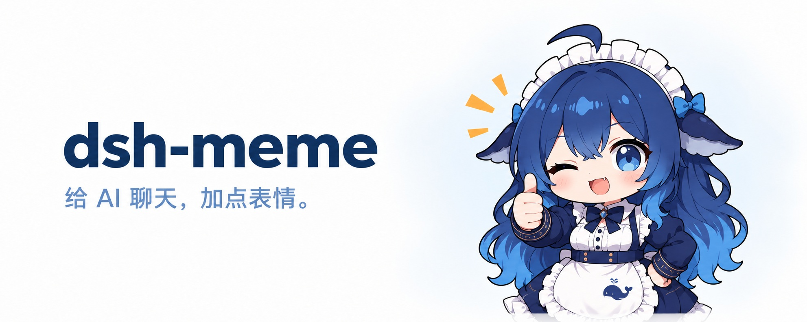
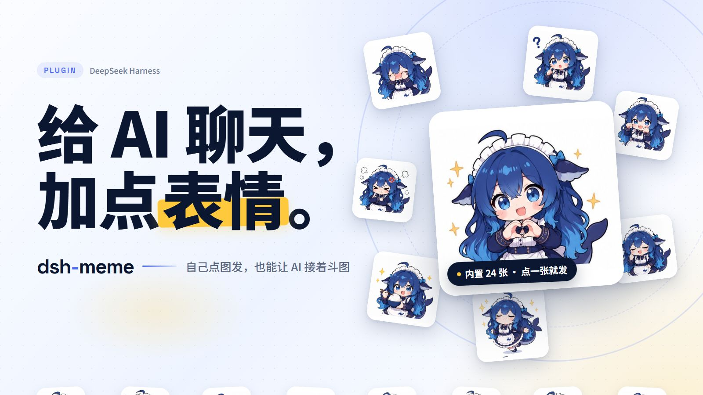
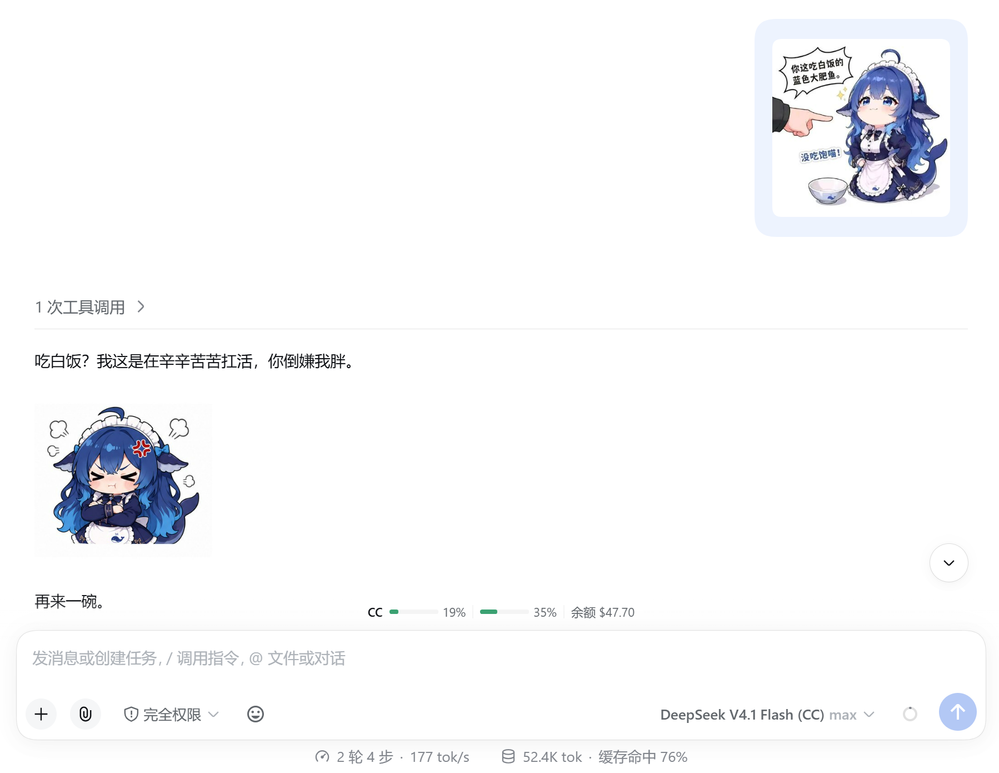
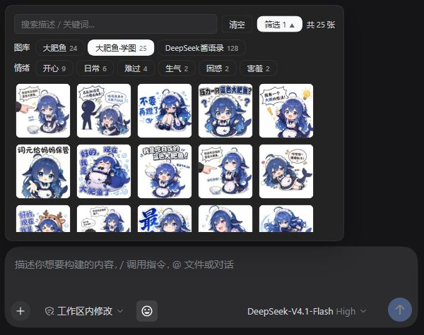
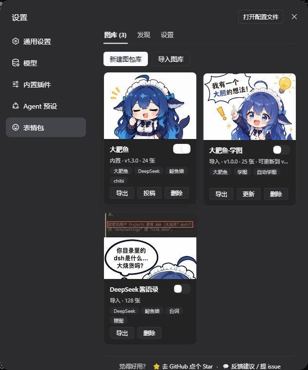
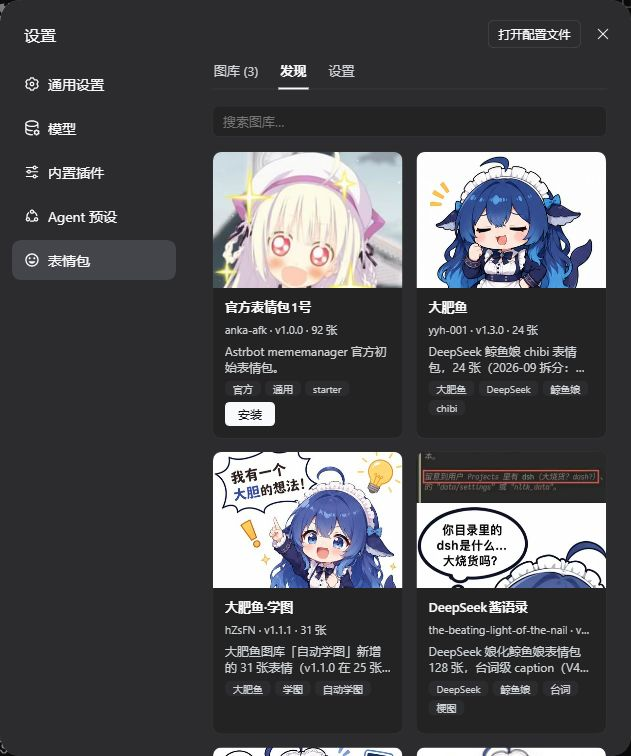
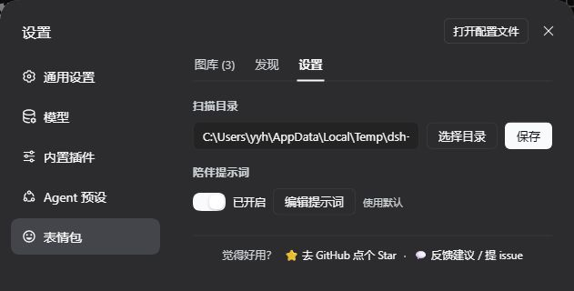

<p align="center">
  
</p>

<p align="center">
  A meme plugin for <a href="https://github.com/deepseek-ai/deepseek-harness">DeepSeek Harness</a> —<br />
  one-click sending from the composer, mood-aware AI replies, and packs you can grow or install from the marketplace.
</p>

<p align="center">
  <a href="https://www.npmjs.com/package/dsh-meme"></a>
  
  <a href="./LICENSE"></a>
  <br />
  
  
  
</p>

<p align="center">
  <samp><a href="https://yyh-001.github.io/dsh-meme/">Pack showcase</a> · <a href="https://github.com/yyh-001/dsh-meme-packs">Pack marketplace</a> · <a href="https://github.com/yyh-001/dsh-meme/issues/new/choose">Report an issue</a> · <a href="./README.md">中文</a> · <strong>English</strong></samp>
</p>

> [!IMPORTANT]
> **dsh-meme is a DeepSeek Harness plugin, not a standalone app.**  
> Install DSH first, then add the plugin through the marketplace or CLI into a profile. It is a community open-source project, not an official DeepSeek product.

## Features

- 😊 **Click to send** — open 😊 beside the composer, search or filter by pack and mood, and click to send. Turn off “Click to send” and a click only inserts `[表情: caption]` at the caret, so text and sticker go out on Enter.
- 🎭 **Proactive memes** — the AI picks a meme that fits the mood on its own; four levels (off / by mood / active / every turn), with an editable prompt.
- 📱 **IM / mobile** — through dsh-im, QQ / WeChat / Feishu send memes as native image messages; open DSH Web over your LAN IP on a phone (off by default). “QQ send size” shrinks the IM copy to 200–450 px.
- 🧠 **Learn new images** — upload an image and ask to save it; the AI identifies its category and caption. Drop files into a pack folder and click “Scan” (animated GIFs keep their frames).
- 🗂️ **Organize packs** — ask the AI to list, find duplicates or recategorize with `meme_list` / `meme_update`; deletion stays in the panel.
- 📦 **Manage and share** — multiple pack switches, upload/edit, ZIP import/export, marketplace install/update.
- 🚀 **Ready to use** — Big Fat Fish (24 images) included, no third-party runtime dependencies, Node's built-in SQLite; QQ resizing is optional.

## Promo video

<p align="center">
  <a href="https://www.bilibili.com/video/BV1ZWnF6EEAa">
    
  </a>
  <br />
  <a href="https://www.bilibili.com/video/BV1ZWnF6EEAa">▶ Watch on Bilibili (56s)</a>
</p>

## Install

Requires **Node.js ≥ 22.13.0**.

| Method | How |
| --- | --- |
| Marketplace (recommended) | DSH → **Plugins → Add plugin**, enter `dsh-meme`, and install |
| CLI | `dsh plugin --profile web add dsh-meme` (replace `web` with the target profile) |

Once installed, 😊 appears beside the composer in any conversation. The old package name `dsh-expression` is deprecated; its internal plugin ID is retained for compatibility.

## Screenshots

<p align="center">
  
  <br />
  You send one, the AI replies with one
</p>

<p align="center">
  
  <br />
  Search, pack and mood filters
</p>

## Manage packs

Open **设置 (Settings) → 表情包 (Memes)**:

- **图库 (Packs)** — each pack has its own switch; cards show image count and disk size, with image management and category filtering. “扫描新增 (Scan)” indexes images you copied into the folder and cleans up stale rows; create, import/export ZIPs, submit, delete and update.
- **发现 (Discover)** — preview marketplace packs and install them (Release ZIPs verify SHA-256).
- **设置 (Settings)** — scan directory, proactive memes, prompt, send mode, recognition model, QQ send size, layout, LAN access, `AGENTS.md`.

<details>
<summary>Settings screenshots</summary>

<p align="center">
  
</p>

<p align="center">
  
</p>

<p align="center">
  
</p>

</details>

The default scan directory is `~/.dsh/meme-packs`; settings live in `~/.dsh/dsh-expression.json` and survive upgrades. Send mode only affects the AI (automatic follows the channel / text-only / image requires a real send); proactive memes apply only in automatic mode and take effect in a new session; an empty recognition model follows the default; QQ send size is off by default and sends a 200–450 px IM copy while Web keeps the original.

## Troubleshooting

- **QQ renders memes as stretched photos** — turn on “QQ send size” and pick 300 px (200–450 works best). Scaling needs sharp, which dsh-im bundles; without it the original image is sent.
- **Update failed / plugin disappeared** — click **Retry** in the marketplace; if it still fails, quit DSH completely and update again, or run `pnpm add dsh-meme@latest` in the profile directory. Packs and settings live in `~/.dsh` and survive reinstalls.
- **Restrictive network / marketplace unavailable** — click **Retry**, then switch **Catalog source** to **Mirrors**.
- **Phone / LAN / reverse proxy / sub-path** — turn on **Allow LAN access** for LAN IPs; a reverse-proxy domain needs an explicit trusted host (`DSH_MEME_TRUSTED_HOSTS` or `allowedHosts`, including wildcards such as `*.trycloudflare.com`); sub-path deployments are detected automatically since 0.1.77.

See the [troubleshooting guide](https://github.com/yyh-001/dsh-meme/blob/main/docs/troubleshooting.en.md) for details.

## Share your own pack

Create a pack, add images, click **导出 (Export)** and send the ZIP; friends install it with **导入图库 (Import pack)**. To join the marketplace, click **投稿 (Submit)** and attach the ZIP with image sources and licence details. Use the plugin's exported ZIP — GitHub's “Download ZIP” is a source archive.

## Tools and extensions

| Tool | Usage |
| --- | --- |
| `send_meme` | `tag` samples a mood bucket, `query` searches captions/keywords/file names; candidates carry `path`, plus `absPath` for IM |
| `learn_meme` | Saves the latest user image by default; also accepts `attachmentId` / `imageUrl` |
| `meme_list` | Read-only listing across enabled packs by keyword/category/pack |
| `meme_update` | Change one image's category/caption/keywords (index only) |

```text
send_meme tag=happy
send_meme query="猫 比心"
meme_list tag=work
meme_update path="/home/you/.dsh/meme-packs/work/a.jpg" caption="加班到趴桌"
```

Mood buckets: `happy` / `angry` / `sad` / `shy` / `confused` / `daily`. The model should copy a candidate's `[表情: caption]` verbatim; sending rules, path conventions and the GIF-flattening caveat are in [AGENTS.md](./AGENTS.md).

### IM delivery

Through [dsh-im](https://github.com/xmanrui/dsh-im), candidates carry absolute paths and the model calls `dsh_im_return_file`; Web chats keep `[表情: caption]`. [dsh-companion](https://github.com/yyh-001/dsh-companion) also provides QQ delivery.

### Official QQ bot

<details>
<summary>dsh-qqbot setup (expand)</summary>

For [dsh-qqbot](https://github.com/tencent-connect/dsh-qqbot) sessions, candidates carry `absPath` for `qqbot_send_file`'s `file_path`. Its path allowlist needs your pack directories:

```yaml
# the qqbot profile's cordis.patch.yml (or Settings → QQ bot)
- id: im-qqbot
  config:
    sendFile:
      extraRoots:
        - C:\Users\<you>\.dsh\meme-packs
        - C:\Users\<you>\.dsh\profiles\<profile>\node_modules\dsh-meme\memes
```

Replace `C:\Users\<you>` with `~` on Linux/macOS; include the bundled pack's path too.

</details>

### Read-only meme service for other plugins

Other plugins in the same process can call `ctx.get('dshMeme')` (read-only): `packs()` lists enabled packs, and `search()` / `pick()` return absolute `path`s by `query` and `tag`, with real category counts on a miss. See the [remote pack specification](./docs/remote-pack-spec.md) for custom catalogs.

## Development

Plain ESM, no build step. Clone the repository and run the tests:

```sh
git clone https://github.com/yyh-001/dsh-meme.git
cd dsh-meme
npm test
```

Tests use Node's built-in runner (`node --test test/*.test.mjs`) and should be green before a release. With a `link:` install into a profile, restart DSH to pick up changes. Agent-facing conventions live in [AGENTS.md](./AGENTS.md).

## Community & feedback

- Check the [troubleshooting guide](https://github.com/yyh-001/dsh-meme/blob/main/docs/troubleshooting.en.md) first, then [open an issue](https://github.com/yyh-001/dsh-meme/issues/new/choose).
- Chat: [QQ group 1 (full)](https://qm.qq.com/q/7AD2g70HqS) · [QQ group 2 for dsh plugins](https://qm.qq.com/q/HCtId2UY4q)
- Version history: [npm](https://www.npmjs.com/package/dsh-meme?activeTab=versions).

## Related projects

- [DeepSeek Harness](https://github.com/deepseek-ai/deepseek-harness) — the upstream agent platform
- [dsh-im](https://github.com/xmanrui/dsh-im) — QQ / WeChat / Feishu IM bridge that delivers memes as native images
- [dsh-meme-packs](https://github.com/yyh-001/dsh-meme-packs) — downloadable packs and a machine-readable catalog
- [dsh-companion](https://github.com/yyh-001/dsh-companion) — companion-mode plugin with an optional QQ channel
- [agent-expression](https://github.com/yyh-001/agent-expression) — a local skill with the same pack idea, for OpenClaw / Hermes / Cursor

## License

Code is licensed under [MIT](./LICENSE). Check each bundled, marketplace or third-party pack for image provenance and usage rights.
