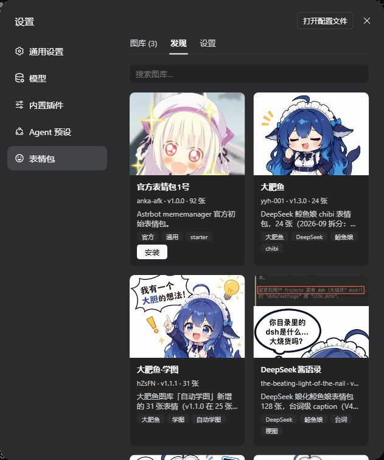
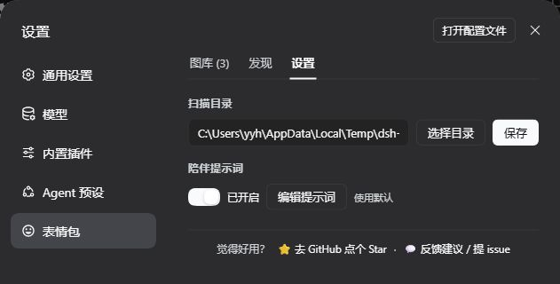

<p align="center">
  
</p>

<p align="center">
  A meme plugin for <a href="https://github.com/deepseek-ai/deepseek-harness">DeepSeek Harness</a> —<br />
  one-click sending from the composer, mood-aware AI replies, and packs you can grow or install from the marketplace.
</p>

<p align="center">
  <a href="https://www.npmjs.com/package/dsh-meme"></a>
  
  <a href="./LICENSE"></a>
  <br />
  
  
  
</p>

<p align="center">
  <samp><a href="https://yyh-001.github.io/dsh-meme/">Pack showcase</a> · <a href="https://github.com/yyh-001/dsh-meme-packs">Pack marketplace</a> · <a href="https://github.com/yyh-001/dsh-meme/issues/new/choose">Report an issue</a> · <a href="./README.md">中文</a> · <strong>English</strong></samp>
</p>

> [!IMPORTANT]
> **dsh-meme is a DeepSeek Harness plugin, not a standalone app.**  
> Install DSH first, then add the plugin through the marketplace or CLI into a profile. It is a community open-source project, not an official DeepSeek product.

## Features

- 😊 **Click to send** — open 😊 beside the composer, search or filter by pack and mood, then pick an image.
- 🎭 **Proactive memes** — the AI picks a meme that fits the conversation's mood without waiting to be asked; toggle “Proactive memes”, set a send chance (0–100%), or edit the prompt in settings.
- 📱 **IM / mobile** — through dsh-im, QQ / WeChat / Feishu and other IM chats send memes as native images with no text marker; on a phone or tablet, open DSH Web over your computer's LAN IP and turn on “Allow LAN access” (off by default). QQ tends to render large images as photos (stretched full-screen on tablets); turn on “QQ send size” in settings to send a 200–450 px copy while Web keeps the original.
- 🧠 **Learn new images** — upload an image and ask to save it; the AI identifies its category and caption. You can also drop image files into a pack folder and click “扫描新增 (Scan)” — the original bytes (including animated GIFs) are kept, and renamed/deleted files have their stale index rows cleaned up.
- 🗂️ **Organize packs** — ask the AI to “list my memes”, “find duplicates” or “recategorize this one” — the `meme_list` / `meme_update` tools handle it (deleting stays in the panel to avoid accidents).
- 📦 **Manage and share** — enable multiple packs, upload and edit images, import/export ZIPs, and install or update marketplace packs.
- 🚀 **Ready to use** — includes Big Fat Fish (24 images); the core has no third-party runtime dependencies and uses Node's built-in SQLite. QQ resizing is optional and uses sharp (already bundled with dsh-im; falls back to the original image when unavailable).

## Promo video

<p align="center">
  <a href="https://www.bilibili.com/video/BV1ZWnF6EEAa">
    
  </a>
  <br />
  <a href="https://www.bilibili.com/video/BV1ZWnF6EEAa">▶ Watch on Bilibili (56s)</a>
</p>

## Install

Requires **Node.js ≥ 22.13.0**.

| Method | How |
| --- | --- |
| Marketplace (recommended) | DSH → **Plugins → Add plugin**, enter `dsh-meme`, and install |
| CLI | `dsh plugin --profile web add dsh-meme` (replace `web` with the target profile) |

Once installed, 😊 appears beside the composer in any conversation. The old package name `dsh-expression` is deprecated; its internal plugin ID is retained for compatibility.

## Screenshots

**Meme exchange: you send one, the AI replies with one**

<p align="center">
  
</p>

**Picker: search, packs and mood filters**

<p align="center">
  
</p>

## Manage packs

Open **设置 (Settings) → 表情包 (Memes)**:

- **图库 (Packs)** — cards show image count and disk size; click a card to manage images. The category dropdown filters by real categories; “扫描新增 (Scan)” indexes images you copied into the folder and cleans up stale rows. Each switch controls whether the AI can use that pack; several can be enabled. Create, import/export ZIPs, submit, delete and update.
- **发现 (Discover)** — preview marketplace packs and install them (Release ZIPs verify SHA-256).
- **设置 (Settings)** — scan directory, proactive memes, prompt, send mode (automatic / text-only / image), send chance (toggle + 0/10/20/30/50/70/100%), QQ send size (toggle + 200/300/400/450 px long edge), layout (side-by-side / full-width row), LAN access, `AGENTS.md`.

<details>
<summary>Settings screenshots (expand)</summary>

**Packs: installed packs with independent switches**

<p align="center">
  
</p>

**Discover: marketplace previews and one-click install**

<p align="center">
  
</p>

**Settings: send mode, send chance and pack directory**

<p align="center">
  
</p>

</details>

The default scan directory is `~/.dsh/meme-packs`; settings live in `~/.dsh/dsh-expression.json` and survive upgrades. ZIP imports accept standard compression and plain image folders.

**Send mode** only affects the AI: automatic follows the channel (Web marker, IM native image), text-only never sends images, image requires a real send every time. **Send chance** is off by default; when enabled, each turn rolls the selected chance to decide whether the AI proactively sends an image (automatic mode only), and a direct request for a meme always bypasses the roll. **QQ send size** is off by default; when enabled, QQ/IM sends a copy scaled to the selected long edge (300 px default), Web keeps the original, and GIF frames are preserved — the official QQ bot has no sticker message type, and smaller images are more likely to render as stickers instead of being stretched full-screen on tablets. **Layout** only affects rendering: side-by-side (default) or a full-width image row.

## Troubleshooting

- **QQ renders memes as stretched photos** — the official QQ bot has no sticker message type, so large images are sent as photos. Turn on “QQ send size” and pick 300 px (200–450 works best); QQ/IM then sends a scaled copy while Web keeps the original. Scaling needs sharp, which dsh-im bundles; without it the original image is sent.
- **Update failed / plugin disappeared** — click **Retry** in the marketplace; if it still fails, quit DSH completely and update again. On older versions, or if it keeps failing, run `pnpm add dsh-meme@latest` in the profile directory with DSH closed. Packs and settings live in `~/.dsh` and survive reinstalls. See the [troubleshooting guide](https://github.com/yyh-001/dsh-meme/blob/main/docs/troubleshooting.en.md).
- **Restrictive network / marketplace unavailable** — mirrors are raced and the catalog is cached automatically; click **Retry**, then switch **Catalog source** to **Mirrors**. See the [troubleshooting guide](https://github.com/yyh-001/dsh-meme/blob/main/docs/troubleshooting.en.md).
- **Phone / LAN / reverse proxy** — turn on **Allow LAN access** for LAN IPs; a reverse-proxy domain needs an explicit trusted host (`DSH_MEME_TRUSTED_HOSTS` or `allowedHosts`). See the [troubleshooting guide](https://github.com/yyh-001/dsh-meme/blob/main/docs/troubleshooting.en.md).

## Share your own pack

Create a pack, add images, click **导出 (Export)** and send the ZIP; friends install it with **导入图库 (Import pack)**. To join the marketplace, click **投稿 (Submit)** and attach the ZIP with image sources and licence details in the prefilled GitHub form. Use the plugin's exported ZIP — GitHub's “Download ZIP” is a source archive, not a pack.

## Tools and extensions

| Tool | Usage |
| --- | --- |
| `send_meme` | `tag` samples a mood bucket, `query` searches captions/keywords/file names across enabled packs; candidates carry `path` (absolute on disk) / `library`, plus `absPath` for IM, and a miss returns real category counts |
| `learn_meme` | Saves the latest user image by default; also accepts `attachmentId` / `imageUrl`; warns when an attached GIF was flattened |
| `meme_list` | Read-only listing across enabled packs by keyword/category/pack, with pack, category, caption, keywords and path |
| `meme_update` | Change one image's category/caption/keywords (index only); pass the path exactly as returned by `meme_list` / `send_meme` |

```text
send_meme tag=happy
send_meme query="猫 比心"
learn_meme
meme_list tag=work
meme_update path="/home/you/.dsh/meme-packs/work/a.jpg" caption="加班到趴桌"
```

Mood buckets: `happy` / `angry` / `sad` / `shy` / `confused` / `daily`. The model should copy a candidate's `[表情: caption]` verbatim; if nothing fits, retry with other words or reply with text.

**Agent docs**: `AGENTS.md` documents per-channel sending, path prefixes and the GIF-flattening caveat; pack maintenance lives in the skill `.dsh/skills/dsh-meme-maintenance`. The settings page can view/edit it.

**Animated GIFs**: `learn_meme` and upload recognition sample GIF frames into a filmstrip, so captions describe motion; the original keeps animating. WebP / APNG contribute metadata only and are recognized from the first frame.

### IM delivery

Through [dsh-im](https://github.com/xmanrui/dsh-im), `send_meme` candidates carry absolute paths and the model calls `dsh_im_return_file`; Web chats keep `[表情: caption]`. [dsh-companion](https://github.com/yyh-001/dsh-companion) also provides QQ delivery.

### Official QQ bot

For [dsh-qqbot](https://github.com/tencent-connect/dsh-qqbot) sessions, candidates carry `absPath` for `qqbot_send_file`'s `file_path`. dsh-qqbot's path allowlist needs your pack directories in `sendFile.extraRoots`:

```yaml
# the qqbot profile's cordis.patch.yml (or Settings → QQ bot)
- id: im-qqbot
  config:
    sendFile:
      extraRoots:
        - C:\Users\<you>\.dsh\meme-packs
        - C:\Users\<you>\.dsh\profiles\<profile>\node_modules\dsh-meme\memes
```

Replace `C:\Users\<you>` with `~` on Linux/macOS; include the bundled pack's path too.

### Read-only meme service for other plugins

Other plugins in the same process can call `ctx.get('dshMeme')` (read-only):

| Method | Returns |
| --- | --- |
| `packs()` | Enabled packs `{ id, name, count, path }[]` |
| `search({ query, tag, limit })` | `{ ok, query, memes: [{ path, tag, caption, keywords, pack, packName }] }` |
| `pick({ query, tag })` | On a hit `{ ok: true, path, tag, caption, keywords, pack, packName }`; otherwise `{ ok: false, reason, tags, tagStats }` |

`tag` is a mood bucket; `tagStats` gives the real category distribution on a miss. Every returned `path` is absolute and exists. For custom catalogs see the [remote pack specification](./docs/remote-pack-spec.md).

Plugin HTTP routes accept loopback hosts by default; LAN and reverse-proxy setup is in the [troubleshooting guide](https://github.com/yyh-001/dsh-meme/blob/main/docs/troubleshooting.en.md).

## Development

Plain ESM, no build step. Clone the repository and run the tests:

```sh
git clone https://github.com/yyh-001/dsh-meme.git
cd dsh-meme
npm test
```

Tests use Node's built-in runner (`node --test test/*.test.mjs`) and should be green before a release. With a `link:` install into a profile, restart DSH to pick up changes. Agent-facing conventions live in [AGENTS.md](./AGENTS.md).

## Community & feedback

- Check the [troubleshooting guide](https://github.com/yyh-001/dsh-meme/blob/main/docs/troubleshooting.en.md) first, then [open an issue](https://github.com/yyh-001/dsh-meme/issues/new/choose).
- Chat: [QQ group 1 (full)](https://qm.qq.com/q/7AD2g70HqS) · [QQ group 2 for dsh plugins](https://qm.qq.com/q/HCtId2UY4q)
- Version history: [npm](https://www.npmjs.com/package/dsh-meme?activeTab=versions).

## Related projects

- [DeepSeek Harness](https://github.com/deepseek-ai/deepseek-harness) — the upstream agent platform
- [dsh-im](https://github.com/xmanrui/dsh-im) — QQ / WeChat / Feishu IM bridge that delivers memes as native images
- [dsh-meme-packs](https://github.com/yyh-001/dsh-meme-packs) — downloadable packs and a machine-readable catalog
- [dsh-companion](https://github.com/yyh-001/dsh-companion) — companion-mode plugin with an optional QQ channel
- [agent-expression](https://github.com/yyh-001/agent-expression) — a local skill with the same pack idea, for OpenClaw / Hermes / Cursor

## License

Code is licensed under [MIT](./LICENSE). Check each bundled, marketplace or third-party pack for image provenance and usage rights.
