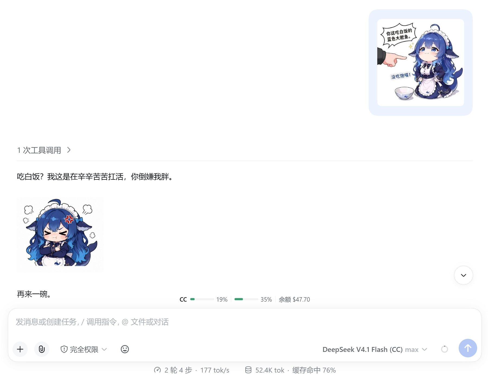
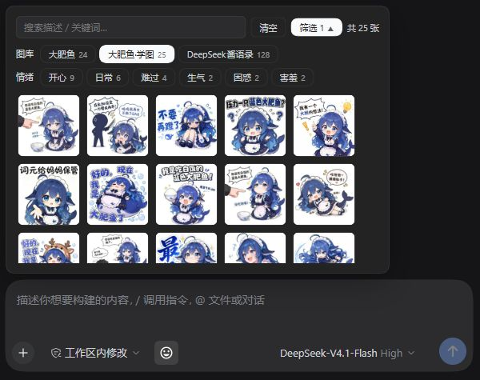
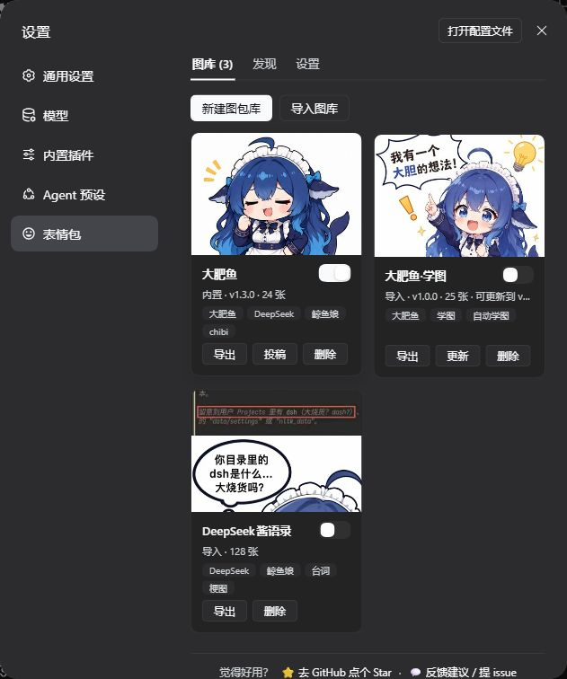

<p align="center">
  
</p>

<p align="center"><strong>Memes for DeepSeek Harness: pick an image yourself, or let your AI join in.</strong></p>

<p align="center">
  <a href="https://www.npmjs.com/package/dsh-meme"></a>
  <a href="./LICENSE"></a>
  
</p>

<p align="center">
  <a href="./README.md">中文</a> · <strong>English</strong><br />
  <a href="https://yyh-001.github.io/dsh-meme/">Pack showcase</a> ·
  <a href="https://github.com/yyh-001/dsh-meme-packs">Pack marketplace</a> ·
  <a href="https://github.com/yyh-001/dsh-meme/issues/new/choose">Report an issue</a> ·
  <a href="https://qm.qq.com/q/7AD2g70HqS">Community &amp; feedback group</a>
</p>

## Features

- **Click to send**: open 😊 beside the composer, search or filter by pack and mood, then pick an image.
- **Chat with memes**: the AI searches by mood or keyword and writes a text marker that becomes an image in chat. Sending needs no image-input support.
- **Learn new images**: upload an image and ask to save it; the AI identifies its category and caption.
- **Manage and share**: enable multiple packs, upload and edit images, import/export ZIPs, and install or update marketplace packs.
- **Ready to use**: includes Big Fat Fish (24 images), with no third-party runtime dependencies; uses Node's built-in SQLite.

## Install

In DSH, open **插件 (Plugins) → 添加插件 (Add plugin)**, enter `dsh-meme`, and install.

Or install into a specific profile:

```bash
dsh plugin --profile web add dsh-meme
```

Requires **Node.js ≥ 22.13.0**. The old package name `dsh-expression` is deprecated; its internal plugin ID is retained for compatibility.

## Get started

| Goal | Action |
| --- | --- |
| Send a meme yourself | Click 😊 beside the composer and pick an image; search, multi-select filters and hover previews are available |
| Ask the AI to send one | Say “send a happy meme” or “find a cat making a heart” |
| Save a new image | Upload it and say “save this image to my meme pack”; automatic recognition requires an image-capable model |
| View a larger image | Click a meme in chat; scroll to zoom, double-click to reset, and press Esc or click the background to close |

In chat: send a meme, and the AI replies with one.

<p align="center">
  
</p>



## Manage packs

Open **设置 (Settings) → 表情包 (Memes)**:

- **图库 (Packs)**: click a card to manage images. Each switch controls whether the AI can use that pack; several can be enabled. Create, import, export, submit or delete packs; “Update” appears when a newer version is available.
- **发现 (Discover)**: preview marketplace packs and install them directly; Release ZIP installations verify SHA-256.
- **设置 (Settings)**: change the scan directory, toggle proactive memes, and edit the prompt.



The default scan directory is `~/.dsh/meme-packs`. Settings are saved in `~/.dsh/dsh-expression.json` and survive upgrades. Install more packs from Discover or import a shared ZIP.

## Share your own pack

1. Create a pack in Packs and add images.
2. Click **导出 (Export)** to get a ZIP. Friends can install it with **导入图库 (Import pack)**.
3. To join the marketplace, click **投稿 (Submit)**. The plugin exports the ZIP and opens a prefilled GitHub form; sign in, attach the ZIP, add image sources and license details, then submit for review.

Use the plugin's exported ZIP. GitHub's “Download ZIP” is a source archive, not a pack export. Exporting still requires a separate GitHub submission; listing follows approval.

## Tools and extensions

| Tool | Usage |
| --- | --- |
| `send_meme` | `tag` samples a mood bucket; `query` searches captions, keywords or file names across all enabled packs |
| `learn_meme` | Saves the most recent user image by default; also accepts `attachmentId` or `imageUrl` |

```text
send_meme tag=happy
send_meme query="猫 比心"
learn_meme
```

Mood buckets: `happy` / `angry` / `sad` / `shy` / `confused` / `daily`. The model should copy a candidate's `[表情: caption]` marker verbatim; the frontend renders it only in chat content. If no candidate fits, try other keywords or reply with text.

For custom catalogs and pack formats, see the [remote pack specification](./docs/remote-pack-spec.md). [dsh-companion](https://github.com/yyh-001/dsh-companion) also provides QQ image delivery.

Plugin HTTP routes accept loopback hosts only (`localhost` / `127.0.0.1` / `[::1]`); LAN addresses and custom domains are rejected.

Code is licensed under [MIT](./LICENSE). Check each pack separately for image provenance and usage rights.
