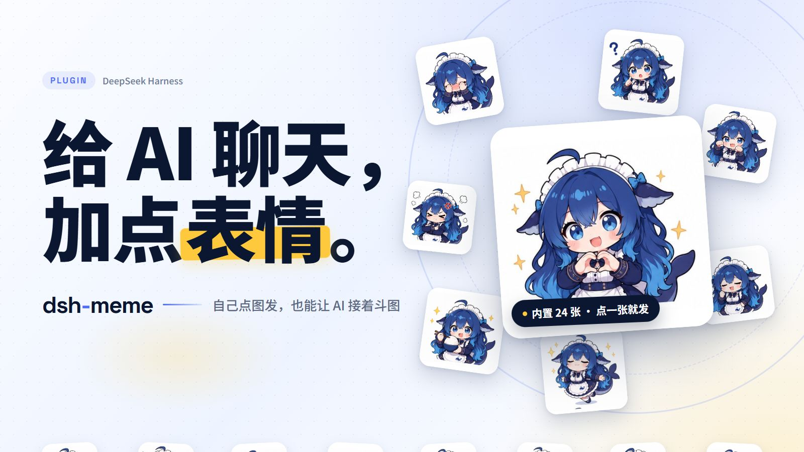

<p align="center">
  
</p>

<p align="center"><strong>给 DeepSeek Harness 加上表情包：自己点图发，也能让 AI 接着斗图。</strong></p>

<p align="center">
  <a href="https://www.npmjs.com/package/dsh-meme"></a>
  <a href="./LICENSE"></a>
  
</p>

<p align="center">
  <a href="https://yyh-001.github.io/dsh-meme/">预览表情包</a> ·
  <a href="https://github.com/yyh-001/dsh-meme-packs">图库市场</a> ·
  <a href="https://github.com/yyh-001/dsh-meme/issues/new/choose">反馈问题</a> ·
  <strong>中文</strong> · <a href="./README.en.md">English</a>
</p>

## 能做什么

- **一键发图**：输入框旁点 😊，搜索、按图库或情绪筛选，点一张就发送。
- **查看大图**：点击聊天里的表情，滚轮缩放、双击复位，Esc 或点背景关闭。
- **跟 AI 斗图**：说「发个开心的表情」或「找一张猫猫比心」，也可以直接按情绪或关键词找图；Web 聊天里模型输出文字标记、前端显示图片，发图无需模型支持图片输入；QQ/微信等 IM 聊天里自动改走 dsh-im 原生图片发送。
- **学会新图**：上传图片后说「把这张图入库」，AI 自动识别分类和描述；也可以把图片文件直接拷进图库目录，点「扫描新增」一键入库（动图 GIF 建议走这条，原始动画保留；文件改名/删除后扫描会顺手清理失效记录）。
- **整理图库**：跟 AI 说「列一下表情包清单」「帮我查查重复」「把这张改成 work 分类」——内置 `meme_list` / `meme_update` 维护工具，改分类/描述/关键词不用手动翻面板（删除留在面板，防误删）。
- **管理与分享**：多图库开关、上传与编辑、ZIP 导入导出、市场安装与更新。
- **收藏不丢**：上传和 AI 学图统一存到 `~/.dsh/meme-packs` 下的「我的收藏」图库（自动启用）——内置图库随插件升级会被整个替换，收藏放在包外，更新插件不再清空。
- **手机也能看**：手机/平板经电脑局域网 IP 打开 DSH Web，设置页打开「局域网访问图库」即可加载表情包（默认关，见下文）。
- **开箱即用**：内置大肥鱼图库（24 张），零第三方运行依赖，使用 Node 内置 SQLite。

## 宣传视频

<p align="center">
  <a href="https://www.bilibili.com/video/BV1ZWnF6EEAa">
    
  </a>
  <br />
  <a href="https://www.bilibili.com/video/BV1ZWnF6EEAa">▶ 在 B 站观看（56 秒）</a>
</p>

## 安装

在 DSH 中打开 **插件 → 添加插件**，输入 `dsh-meme` 并安装。

也可以安装到指定 profile：

```bash
dsh plugin --profile web add dsh-meme
```

需要 **Node.js ≥ 22.13.0**。旧包名 `dsh-expression` 已弃用，内部插件 ID 保留兼容。

## 效果预览

你发一张，AI 接着回一张。

<p align="center">
  
</p>


## 图库管理

打开 **设置 → 表情包**：

- **图库**：点卡片管理图片；分类下拉列出图库里**真实的分类**（按张数排序，筛选是精确匹配，不会把相近分类混进来）；「扫描新增」把图库目录里手动拷入的图片收进索引（分类取子目录名、描述取文件名），同时清理文件被改名/删除后的失效记录。卡片开关决定 AI 能否使用该图库，可同时启用多个。支持新建、导入（常规压缩方式都行；**纯图片 ZIP 也能直接导入**，自动按目录名分类）、导出、投稿和删除，有新版时显示「更新」。
- **发现**：预览市场图库，一键安装；Release ZIP 安装时校验 SHA-256。
- **设置**：修改扫描目录，开启或关闭 AI 主动发表情，编辑提示词，选择 AI 的发送方式（自动 / 纯文字 / 图片）与表情排布（并排 / 独占一行），开关「局域网访问图库」，查看/编辑 `AGENTS.md`（给 agent 的操作约定）。


默认扫描 `~/.dsh/meme-packs`，设置保存在 `~/.dsh/dsh-expression.json`，升级插件会保留。更多图库可在「发现」安装，也可导入别人分享的 ZIP（插件导出的包是标准格式；朋友只给你一堆图片也能打包成 ZIP 直接导入，自动按目录名建索引）。

「发送方式」只控制 AI 怎么发图，不影响前端把 `[表情: 描述]` 配成图片：**自动**（默认）按渠道来，Web 聊天写标记、IM 聊天发原生图片；**纯文字**只让 AI 用文字接梗，不发图片；**图片**要求 AI 每次挑好图都真的发出去。保存后下一条消息生效。**表情排布**决定图文同条时怎么排：**并排**（默认，紧凑）或**独占一行**（图在上、正文按正常宽度铺开），切换即时生效，只影响前端渲染。

## 插件更新失败 / 更新后消失？

在市场里点「更新」时，宿主会用 pnpm 把 `node_modules/dsh-meme` 整个目录改名替换。**Windows 上只要目录里还有打开的文件，rename 就会 `EPERM`**，pnpm 只能报 `exit 1`；市场界面往往只留一行 `exit 1`，完整报错被截断，看起来像「没报错但失败了」。失败后目录可能只装了一半，再进市场会校验失败（例如提示 `ENOENT ... cordis.patch.yml`），插件列表里也找不到它。

**0.1.59 起插件侧已修（issue [#43](https://github.com/yyh-001/dsh-meme/issues/43)）**：以前的版本在启动时会一直打开内置图库的 `memes/dafeiyu-001/index.db`（管理面板还有一条常驻可写连接），这个文件就在插件包目录里 → 更新时包目录被占住，pnpm 改名必然失败（`ERR_PNPM_EPERM ... rename '..._tmp_...' -> '...dsh-meme'`）。现在图库索引只在启动时读一次进内存，上传/学图时临时打开、写完立刻关闭，内置图库激活时插件不再长期占用包内任何文件。这也解释了以前「有时成功有时失败」：激活的是 `~/.dsh/meme-packs` 里的用户图库时不占包目录，激活内置图库时才会卡住更新。

在 0.1.59 之前更新失败的用户，仍按下面三步处理：

1. **完全退出 DSH**（托盘图标退出，任务管理器里确认没有 dsh / Electron 进程），重新打开后再点一次更新。
2. 还失败，或插件已从列表消失：**退出 DSH 后**到对应 profile 目录手动更新（默认在 `~/.dsh/profiles/<profile>`；桌面版是 `desktop`，Web / CLI 常见 `web`）：

   ```bash
   cd ~/.dsh/profiles/web
   pnpm add dsh-meme@latest
   ```

   然后重新打开 DSH，在「设置 → 表情包」确认插件已启用。
3. 图库和设置都存在 `~/.dsh`（`dsh-expression.json` 等），更新或重装不会丢；仍不行可以先卸载再重装。

升到 0.1.59 之后仍更新失败，说明占用来自插件之外（宿主进程、杀毒软件或其它程序）：把 profile 目录、市场里的 `exit 1` 上下文和是否有 `ERR_PNPM_EPERM` 一并反馈给 DSH 插件市场；插件这边已确认不再占用包内文件，有一个回归测试专门模拟 pnpm 改名（`test/update-lock.test.mjs`）。

## 国内网络 / 图库市场拉不到？

图库目录和预览图托管在 GitHub 上，国内直连 `raw.githubusercontent.com` / `cdn.jsdelivr.net` 经常超时，发现页于是显示「图库目录暂不可用(检查网络或稍后重试)」。插件默认走多镜像，通常无需配置：

- **自动竞速**：目录、清单 JSON、安装 ZIP 和逐图下载都会尝试原始地址和 `ghfast.top`、`gh-proxy.com`、`ghproxy.net`、`cdn.jsdmirror.com`、`fastly.jsdelivr.net` 等镜像，取最先成功的；封面和预览图逐个候选回退，并记住能用的镜像。
- **磁盘缓存**：成功拉到的目录存到 `~/.dsh/dsh-meme-catalog-cache.json`，网络暂时不通时先用它显示，并提示「当前使用本地缓存」。
- **安装仍校验 SHA-256**：镜像只换下载通道，镜像返回的 ZIP 哈希对不上会自动换下一个，不会装进坏包。

拉不到时按顺序排查：

1. 点发现页的 **重试**；
2. 打开 **设置 → 表情包 →「设置」**，看「图库目录源」的 **当前源**，确认自定义地址没写错（地址错也会这样）；
3. 在「图库目录源」下拉框选 **镜像源**（只走国内加速节点，最稳）；还不行再选 **自定义地址**，填一个你能访问的 `catalog.json` 地址并保存，或切回 **自动**。也可以直接改 `~/.dsh/dsh-expression.json` 的 `"remoteDirUrl"`（`""`/`auto` = 自动、`official` = 官方直连、`mirror` = 国内镜像、或自定义 URL），即时生效。

自查镜像连通性（任一返回 `200` 即可）：

```bash
curl -I https://ghfast.top/https://raw.githubusercontent.com/yyh-001/dsh-meme-packs/main/catalog.json
curl -o /dev/null -w '%{http_code}\n' https://cdn.jsdmirror.com/gh/yyh-001/dsh-meme-packs@main/catalog.json
curl -o /dev/null -w '%{http_code}\n' https://gh-proxy.com/https://raw.githubusercontent.com/yyh-001/dsh-meme-packs/main/catalog.json
```

## 分享自己的图库

1. 在「图库」新建图包库，添加图片。
2. 点 **导出** 得到 ZIP，朋友用 **导入图库** 即可安装。
3. 想收录到市场，点 **投稿**：插件导出 ZIP 并打开预填的 GitHub 表单；登录后附上 ZIP、图片来源与许可，再提交审核。

请使用插件导出的 ZIP。GitHub 的「Download ZIP」是仓库源码压缩包，不能替代图库分享包。导出完成后仍需在 GitHub 提交，审核通过才会收录。

## 工具与扩展

| 工具 | 用法 |
| --- | --- |
| `send_meme` | `tag` 按情绪随机抽图，`query` 按描述、关键词或文件名搜索；范围为所有启用的图库。候选附带 `path` / `library` 出处信息；搜索没命中时返回图库里真实的分类统计，便于换词重试 |
| `learn_meme` | 默认收录最近一张用户图片，也可指定 `attachmentId` 或 `imageUrl`；附件 GIF 被宿主压成单帧时会在结果里提示 |
| `meme_list` | 只读清单：跨启用图库按关键词/分类/图库筛选，每张带所属图库、分类、描述、关键词和 path；查重复、核对分类用 |
| `meme_update` | 改一张图的分类/描述/关键词（只改索引不动文件，至少给一项）；path 用 `meme_list` / `send_meme` 候选里的原样 |

```text
send_meme tag=happy
send_meme query="猫 比心"
learn_meme
meme_list tag=work
meme_update path="memes/work/a.jpg" caption="加班到趴桌"
```

情绪桶：`happy` / `angry` / `sad` / `shy` / `confused` / `daily`。模型应把候选中的 `[表情: 描述]` 原样写进回复；前端只在聊天内容中配图。没有合适的候选时，换关键词或用文字回复。

**给 agent 的说明**：包内 `AGENTS.md` 写了发图方式的判定规则、path 前缀约定和 GIF 压平的坑（工作目录在插件目录里的 agent 新开会话自动读取）；整理图库的完整流程（查重、批量改分类、扫描入库）在项目级 skill `.dsh/skills/dsh-meme-maintenance` 里，按需加载。设置页「Agent 说明(AGENTS.md)」可以直接查看/编辑这份约定。

**动图读取**：`learn_meme` 和上传弹窗的 AI 识图支持 GIF 动图——先把动图按时间轴均匀采样成几帧、拼成一张带帧序说明的胶片条再送模型，所以 caption 能描述「猫疯狂摇头」这类动作，而不是只看见第一帧。原图照旧入库，聊天里仍然会动。动图 WebP / APNG 目前只能读帧数、时长等元数据（仍按第一帧识别），提示词里会注明它是动图。解码是纯 JS 实现，不引入第三方依赖。

通过 [dsh-im](https://github.com/xmanrui/dsh-im) 接入 QQ / 微信 / 飞书 / 企业微信等 IM 时，表情包会以该聊天的原生图片消息发出：插件按会话来源识别 IM 渠道后，`send_meme` 的候选会额外带**绝对路径**，模型随后调用 dsh-im 的 `dsh_im_return_file` 把图交给渠道；IM 聊天不渲染 `[表情: 描述]`，所以不会再写标记。这条投递规则随主动斗图提示词一起自动注入——**不需要先跟模型说明「可以在 QQ/微信里发表情包」**。Web 聊天保持原来的 `[表情: 描述]` 配图方式，两种会话可以同时存在。

自建图库目录或市场源见 [远程图库规范](./docs/remote-pack-spec.md)。通过 [dsh-companion](https://github.com/yyh-001/dsh-companion) 也可接入 QQ 发图。

**QQ 官方机器人（[dsh-qqbot](https://github.com/tencent-connect/dsh-qqbot)）**：安装该插件后，`send_meme` 候选会带 `absPath`（绝对路径），投递说明会让模型把挑中候的 `absPath` 交给 `qqbot_send_file` 的 `file_path`（不再写 `[表情: 描述]` 标记）。dsh-qqbot 默认启用**路径白名单**（仅 media 目录 + agent 工作目录 + `sendFile.extraRoots`），所以要把图库目录加进去，否则发送会被拒绝：

```yaml
# qqbot profile 的 cordis.patch.yml（或用「设置 → QQ 机器人」的配置编辑）
- id: im-qqbot
  config:
    sendFile:
      extraRoots:
        - C:\Users\<你>\.dsh\meme-packs        # 「我的收藏」与用户图库
        - C:\Users\<你>\.dsh\profiles\<profile>\node_modules\dsh-meme\memes  # 内置大肥鱼图库
```

`C:\Users\<你>` 在 Linux/macOS 上换成 `~`。图库放哪就把哪个目录加进去；`send_meme` 可以跨所有启用的图库取图，所以内置图库的路径也要加。

### 给其它插件的只读取图服务

同一 DSH 进程内的其它插件（以及跑在里面的 agent 工具）可以直接 `ctx.get('dshMeme')` 拿到本插件的原生检索能力，不用自己读图库索引、也不会读到脏数据：

| 方法 | 返回 |
| --- | --- |
| `packs()` | 已启用的图库 `{ id, name, count, path }[]` |
| `search({ query, tag, limit })` | `{ ok, query, memes: [{ path, tag, caption, keywords, pack, packName }] }` |
| `pick({ query, tag })` | 成功 `{ ok: true, path, tag, caption, keywords, pack, packName }`；没命中 `{ ok: false, reason, tags, tagStats }`（**不会瞎塞一张**） |

`query` 按关键词/文件名搜（跨所有启用的图库），`tag` 是情绪桶（`happy/angry/sad/shy/confused/daily`）。没命中时 `tags` 是六个情绪桶，`tagStats` 是启用图库里的真实分类分布（`{ tag, count }[]`，按张数降序），方便调用方让模型换词。服务只读、幂等、不发送任何消息；返回的 `path` 一定是磁盘绝对路径且文件存在。B站评论区配图就是接的这个服务。

插件 HTTP 接口默认只接受本机回环地址（`localhost` / `127.0.0.1` / `[::1]`）。手机/平板通过电脑的局域网 IP 访问 DSH Web 时，在插件设置页打开 **「局域网访问图库」**（默认关）即可加载表情包——只放行 IP 字面量（回环/私有网段/链路本地）；记得系统防火墙放行该端口。

**反向代理部署**（浏览器 → `https://你的域名` → nginx/frp → `127.0.0.1:2233`）时 Host 是你的域名，需要显式声明可信域名（issue #56；默认空名单，行为完全不变）：

```bash
# 环境变量：容器/反代场景不用改 profile
DSH_MEME_TRUSTED_HOSTS=feiyu.example.com
```

```yaml
# 或 profile 的 cordis.patch.yml
- id: dsh-expression
  config:
    allowedHosts:
      - feiyu.example.com
```

只做精确主机名匹配（大小写、端口、末尾点不敏感，不支持通配符）；没写进名单的域名仍然拒绝，DNS rebinding 防线不变。插件本身没有鉴权，反代域名务必由代理层做登录/访问控制。

## 交流反馈

[QQ 1 群（已满）](https://qm.qq.com/q/7AD2g70HqS) · [dsh 插件 2 群](https://qm.qq.com/q/HCtId2UY4q)

代码采用 [MIT](./LICENSE) 许可；图库图片的来源与使用许可请分别查看各图库说明。
