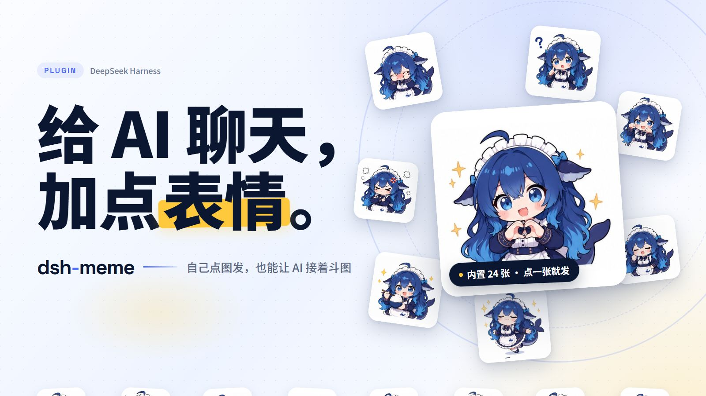
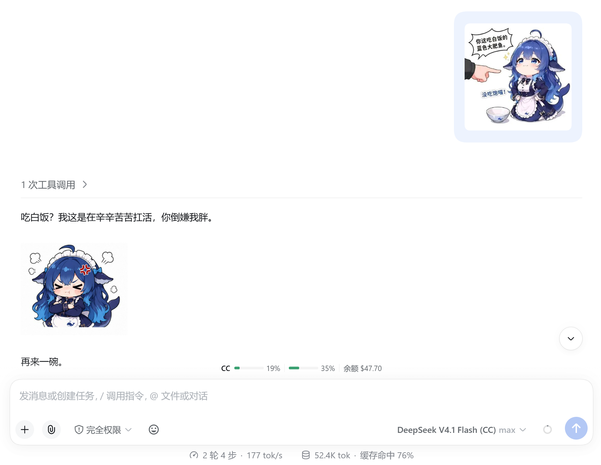
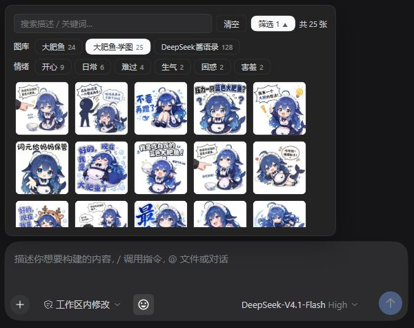
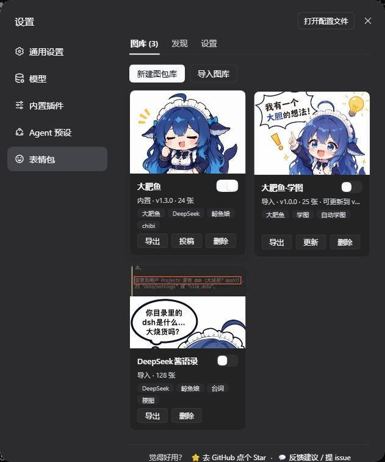
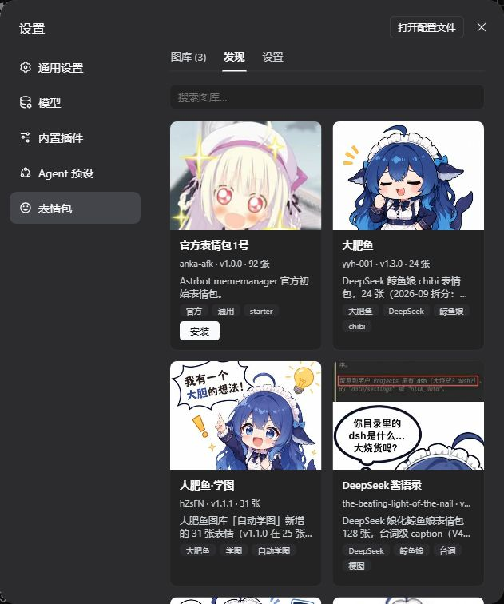
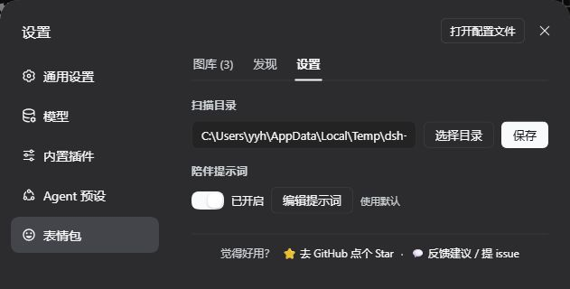

<p align="center">
  
</p>

<p align="center">
  <a href="https://github.com/deepseek-ai/deepseek-harness">DeepSeek Harness</a> 的表情包插件 ——<br />
  输入框一键发图，AI 按聊天气氛接梗；图库能自己养，也能从市场装。
</p>

<p align="center">
  <a href="https://www.npmjs.com/package/dsh-meme"></a>
  
  <a href="./LICENSE"></a>
  <br />
  
  
  
</p>

<p align="center">
  <samp><a href="https://yyh-001.github.io/dsh-meme/">预览表情包</a> · <a href="https://github.com/yyh-001/dsh-meme-packs">图库市场</a> · <a href="https://github.com/yyh-001/dsh-meme/issues/new/choose">反馈问题</a> · <a href="./README.en.md">English</a> · <strong>中文</strong></samp>
</p>

> [!IMPORTANT]
> **dsh-meme 是 DeepSeek Harness 的插件，不是独立应用。**  
> 需要先装好 DSH，再通过插件市场或 CLI 装进某个 profile；社区开源项目，并非 DeepSeek 官方产品。

## 功能

- 😊 **一键发图** — 输入框旁点 😊，搜索或按图库、情绪筛选，点图直接发送；关掉「点图直接发送」后只把 `[表情: 描述]` 插到光标处，随文字一起发。
- 🎭 **主动斗图** — AI 按聊天情绪自己找图接梗，分「关闭 / 看气氛 / 活跃 / 每轮都发」四档，提示词可改。
- 📱 **IM / 手机斗图** — 经 dsh-im 接入 QQ、微信、飞书后，表情包以原生图片消息发出；手机经局域网 IP 打开 DSH Web 收发（默认关）。QQ 大图可开「QQ 发图尺寸」缩到 200–450px。
- 🧠 **学会新图** — 上传图片说「把这张图入库」，AI 自动识别分类和描述；也可把图片拷进图库目录后点「扫描新增」（GIF 保留动画）。
- 🗂️ **整理图库** — 用 `meme_list` / `meme_update` 让 AI 列清单、查重、改分类；删除留在面板，防误删。
- 📦 **管理与分享** — 多图库开关、上传编辑、ZIP 导入导出、市场安装更新。
- 🚀 **开箱即用** — 内置大肥鱼图库（24 张），零第三方运行依赖，使用 Node 内置 SQLite；QQ 缩图为可选能力。

## 宣传视频

<p align="center">
  <a href="https://www.bilibili.com/video/BV1ZWnF6EEAa">
    
  </a>
  <br />
  <a href="https://www.bilibili.com/video/BV1ZWnF6EEAa">▶ 在 B 站观看（56 秒）</a>
</p>

## 安装

需要 **Node.js ≥ 22.13.0**。

| 方式 | 做法 |
| --- | --- |
| 插件市场（推荐） | DSH → **插件 → 添加插件**，输入 `dsh-meme` 并安装 |
| 命令行 | `dsh plugin --profile web add dsh-meme`，把 `web` 换成目标 profile |

装好后打开任意会话，输入框旁会出现 😊。旧包名 `dsh-expression` 已弃用，内部插件 ID 保留兼容。

## 效果预览

<p align="center">
  
  <br />
  你发一张，AI 接着回一张
</p>

<p align="center">
  
  <br />
  搜索、图库与情绪筛选
</p>

## 图库管理

打开 **设置 → 表情包**：

- **图库** — 每个图库独立开关；卡片显示张数与占用，可管理图片、按分类筛选；「扫描新增」收编手动拷入的图片并清理失效记录；支持新建、ZIP 导入导出、投稿、删除与更新。
- **发现** — 预览市场图库并一键安装（Release ZIP 校验 SHA-256）。
- **设置** — 扫描目录、主动发图、提示词、发送方式、识图模型、QQ 发图尺寸、表情排布、局域网访问、`AGENTS.md`。

<details>
<summary>设置页截图</summary>

<p align="center">
  
</p>

<p align="center">
  
</p>

<p align="center">
  
</p>

</details>

默认扫描 `~/.dsh/meme-packs`，设置存 `~/.dsh/dsh-expression.json`，升级保留。发送方式只影响 AI（自动按渠道 / 纯文字 / 图片要求真发）；主动发图仅在自动模式下生效，新开会话生效；识图模型留空跟随默认；QQ 发图尺寸默认关，打开后 IM 发送 200–450px 副本，Web 仍用原图。

## 常见问题

- **QQ 发表情被当大图拉伸** — 打开「QQ 发图尺寸」，选 300px（经验区间 200–450）；缩放需 sharp，dsh-im 已自带，缺失时按原图发送。
- **更新失败 / 插件消失** — 市场点「重试」；仍失败就完全退出 DSH 后更新，必要时在 profile 目录执行 `pnpm add dsh-meme@latest`。图库和设置在 `~/.dsh`，重装不丢。
- **国内网络 / 市场拉不到** — 先点「重试」，再把「图库目录源」切到「镜像源」。
- **手机 / 局域网 / 反代 / 子路径** — 设置页打开「局域网访问图库」；反代需显式声明可信 Host（`DSH_MEME_TRUSTED_HOSTS` 或 `allowedHosts`，支持 `*.trycloudflare.com` 这类通配）；子路径部署从 0.1.77 起自动适配。

更多见 [排障手册](https://github.com/yyh-001/dsh-meme/blob/main/docs/troubleshooting.md)。

## 分享自己的图库

新建图包库加图 → **导出** ZIP 给朋友 **导入**；想进市场点 **投稿**，按预填表单附上 ZIP、图片来源与许可。请用插件导出的 ZIP，GitHub「Download ZIP」是源码包。

## 工具与扩展

| 工具 | 用法 |
| --- | --- |
| `send_meme` | 按情绪 `tag` 抽图，或按 `query` 搜描述/关键词/文件名；候选带 `path`，IM 场景另有 `absPath` |
| `learn_meme` | 收录最近一张用户图片，也可指定 `attachmentId` / `imageUrl` |
| `meme_list` | 跨启用图库按关键词/分类/图库列清单 |
| `meme_update` | 改一张图的分类/描述/关键词（只改索引，不动文件） |

```text
send_meme tag=happy
send_meme query="猫 比心"
meme_list tag=work
meme_update path="C:\Users\<你>\.dsh\meme-packs\work\a.jpg" caption="加班到趴桌"
```

情绪桶：`happy` / `angry` / `sad` / `shy` / `confused` / `daily`。模型把候选里的 `[表情: 描述]` 原样写进回复；发图判定、path 约定与 GIF 压平的坑见 [AGENTS.md](./AGENTS.md)。

### IM 投递

经 [dsh-im](https://github.com/xmanrui/dsh-im) 接入后，候选带绝对路径，模型调用 `dsh_im_return_file` 发原生图片；Web 聊天仍用 `[表情: 描述]`。通过 [dsh-companion](https://github.com/yyh-001/dsh-companion) 也可接 QQ。

### QQ 官方机器人

<details>
<summary>dsh-qqbot 配置（展开）</summary>

对 [dsh-qqbot](https://github.com/tencent-connect/dsh-qqbot) 会话，候选带 `absPath`，交给 `qqbot_send_file` 的 `file_path`。默认路径白名单需加入图库目录：

```yaml
# qqbot profile 的 cordis.patch.yml（或「设置 → QQ 机器人」）
- id: im-qqbot
  config:
    sendFile:
      extraRoots:
        - C:\Users\<你>\.dsh\meme-packs
        - C:\Users\<你>\.dsh\profiles\<profile>\node_modules\dsh-meme\memes
```

`C:\Users\<你>` 在 Linux/macOS 换成 `~`；图库放哪就加哪个目录，内置图库路径也要加。

</details>

### 给其它插件的只读服务

同进程插件可用 `ctx.get('dshMeme')` 检索/挑图（只读）：`packs()` 列已启用图库，`search()` / `pick()` 按 `query`、`tag` 返回带绝对 `path` 的结果，未命中时给出真实分类统计。自建图库目录或市场源见 [远程图库规范](./docs/remote-pack-spec.md)。

## 开发

纯 ESM，没有构建步骤。克隆仓库后直接跑测试：

```sh
git clone https://github.com/yyh-001/dsh-meme.git
cd dsh-meme
npm test
```

测试用 Node 内置 test runner（`node --test test/*.test.mjs`），发版前应全绿。本机用 `link:` 装进 profile 时，改完代码重启 DSH 即生效；给 agent 的硬约定见 [AGENTS.md](./AGENTS.md)。

## 交流反馈

- 遇到问题先看 [排障手册](https://github.com/yyh-001/dsh-meme/blob/main/docs/troubleshooting.md)，没解决就 [开 issue](https://github.com/yyh-001/dsh-meme/issues/new/choose)。
- 交流群：[QQ 1 群（已满）](https://qm.qq.com/q/7AD2g70HqS) · [dsh 插件 2 群](https://qm.qq.com/q/HCtId2UY4q)
- 版本更新见 [npm](https://www.npmjs.com/package/dsh-meme?activeTab=versions)。

## 相关项目

- [DeepSeek Harness](https://github.com/deepseek-ai/deepseek-harness) — 上游 agent 平台
- [dsh-im](https://github.com/xmanrui/dsh-im) — QQ / 微信 / 飞书等 IM 接入，表情包以原生图片发送
- [dsh-meme-packs](https://github.com/yyh-001/dsh-meme-packs) — 可下载图库与机器可读目录
- [dsh-companion](https://github.com/yyh-001/dsh-companion) — 陪伴模式插件，也能接 QQ 通道
- [agent-expression](https://github.com/yyh-001/agent-expression) — 同一套图库思路的本地 Skill，适配 OpenClaw / Hermes / Cursor

## 许可

代码采用 [MIT](./LICENSE) 许可。内置、市场与第三方图库的图片版权与使用范围见各图库说明。
